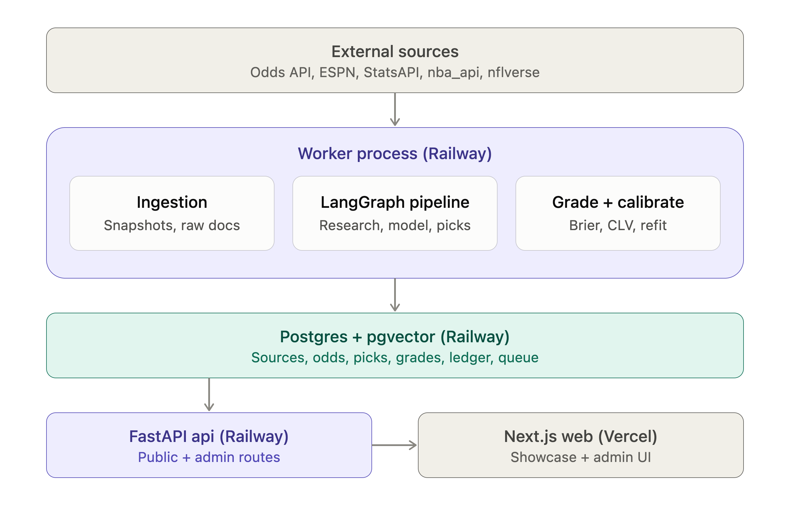

# Sharpline

[](https://github.com/justinj8/sharpline/actions/workflows/ci.yml)

A multi-sport (NBA, NFL, MLB) agentic forecasting platform. One LangGraph pipeline
(research → model → picks) with a module per sport, task-based model routing
(Haiku ingests, Sonnet analyzes, Opus writes the final card), a grounding gate that
drops any pick whose odds, injury or projection claims cannot be traced to a fetched
source, and a calibration layer scored by Brier score and closing line value. Every
run's cost is recorded.

> Status: **Phase 0 — Foundation, deployed.** Live health check:
> <https://api-production-e3800.up.railway.app/v1/health>. See `docs/superpowers/specs/` for the design and
> `docs/superpowers/plans/` for phase plans. All tracking is paper tracking for
> research; nothing here is betting advice.

## Quickstart

Prerequisites: [uv](https://docs.astral.sh/uv/), Python 3.12, the [Railway CLI](https://docs.railway.com/guides/cli). No local Docker: development and integration tests use the Railway `dev` environment Postgres.

```bash
uv sync --all-packages        # create the workspace venv
cp .env.example .env          # paste the Railway dev Postgres URLs
uv run pre-commit install
make db.migrate               # apply migrations
make dev                      # run the API on :8000
curl localhost:8000/v1/health
```

### Railway dev database

The `sharpline` Railway project has a `dev` environment with Postgres 18 (pgvector) exposed
through a TCP proxy. `.env` holds its public URL as both `DATABASE_URL` and
`TEST_DATABASE_URL`; integration tests create and drop `sharpline_test_*` databases on it.
Get the values from the Railway dashboard (Postgres service → Variables:
`RAILWAY_TCP_PROXY_DOMAIN`, `RAILWAY_TCP_PROXY_PORT`, `PGUSER`, `POSTGRES_PASSWORD`,
`PGDATABASE`). Never commit `.env`.

## Deployment

Production runs on Railway. `.railway/railway.ts` (Railway infrastructure-as-code) defines
the whole `production` environment: Postgres 18 with pgvector, the `api` service and the
`worker` service. Both services build from `main` with Railpack (`railpack.json`).

```bash
railway environment production
railway config plan        # read-only preview of infrastructure changes
railway config apply       # apply after reviewing the plan
```

- **api** runs `alembic upgrade head` as a pre-deploy step and is health-checked on `/v1/health`.
- **worker** runs procrastinate and logs a `worker.heartbeat` every 5 minutes.
- **Secrets:** the services reference `DATABASE_URL` from the Postgres service; no secret
  values are in the repo.
- The `dev` environment (local development and integration tests) is deliberately *not*
  managed by the file, which refuses to plan against it.



## Layout

```
apps/api/        FastAPI service (sharpline_api)
apps/worker/     procrastinate scheduler/worker (sharpline_worker)
.railway/        Railway infrastructure-as-code (production)
src/sharpline/   core library: config, domain, db
db/migrations/   Alembic migrations
tests/           unit (no I/O) and integration (TEST_DATABASE_URL)
docs/            specs, plans, ADRs
```

## Make targets

| Target | What it does |
|---|---|
| `make fmt` | Format and autofix with ruff |
| `make lint` | ruff check + format check |
| `make typecheck` | mypy (strict) |
| `make test` | full test suite |
| `make test.unit` | tests that need no database |
| `make test.integration` | tests against `TEST_DATABASE_URL` |
| `make check` | lint + typecheck + test |
| `make db.migrate` | `alembic upgrade head` |
| `make dev` | run the API with reload |
| `make worker` | run the procrastinate worker |
